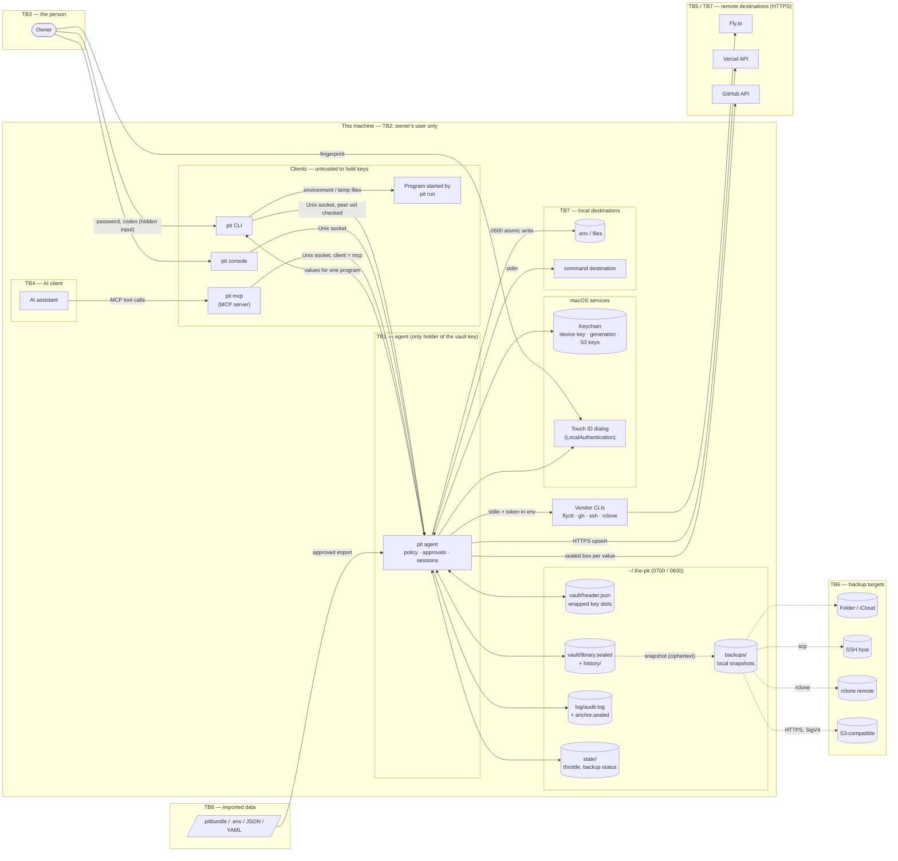

# The Pit — threat model

| | |
| --- | --- |
| **Version covered** | 0.1.1 |
| **Date** | 2026-10-15 |
| **Method** | STRIDE per element, over the data-flow diagram below |
| **Scope** | The `pit` binary (CLI, console, agent, MCP server), its files on disk, its backups, and the integrations it pushes to |
| **Maintenance** | Kept in the repository next to the code and updated in the same pull request as any change listed under [Review triggers](#review-triggers). Index of all assurance material: [README.md](README.md); latest automated results: <https://oscillatingmonkey.github.io/the-pit/> |

This document describes **what The Pit defends against, how, and what it leaves to you**. It is a
design-level description. It does not describe how to attack a vault. It agrees with
[docs/security.md](../security.md) and [SECURITY.md](../../SECURITY.md); if they ever disagree, treat
that as a bug and report it.

Source references are to files and functions in `src/` at version 0.1.1.

---

## 1. Assets

| Asset | Where it lives | Why it matters |
| --- | --- | --- |
| **Vault key** (256-bit, random) | Only in the agent's memory while unlocked; on disk only *wrapped* in key slots (`vault/header.json`) | Opens everything. Subkeys for the library, values, audit log and fingerprints are derived from it (`vault::Keys::from`, HKDF-SHA256). |
| **Secret values** | `vault/library.sealed` and `vault/history/`; each `sealed` value is encrypted a second time, bound to its secret id (`values::store`, `values::aad`) | The thing users protect. |
| **Password, recovery code, recovery shares** | In the person's head, on paper or in another password manager; never stored by The Pit | Each unwraps a key slot. The recovery code (256 random bits) can also reset the other factors. |
| **Device key** (quick unlock) | macOS Keychain, item `dev.thepit` / `vault-<id>-device` | Unwraps the device slot; the agent only uses it after Touch ID. |
| **Second factor** (TOTP secret, Touch ID enrollment) | TOTP secret inside the encrypted library; Touch ID in the Secure Enclave (managed by macOS) | Required after the password, and for approvals. |
| **Audit log** | `log/audit.log`, `log/anchor.sealed` | Record of every unlock, push, reveal and change, including which program asked. Must be trustworthy after an incident. |
| **Rollback anchor** | Keychain item `vault-<id>-generation` | Lets the agent refuse an older library file put back in place of the current one. |
| **Backups** | `.pitvault` snapshots on every target; `.pitbundle` exports | Hold the same ciphertext as the vault, and the key slots that open it. |
| **Destination credentials** | Connection tokens (sealed in the library), borrowed CLI sessions (`gh`, `flyctl`), S3 keys (Keychain) | Let The Pit write to Fly, Vercel, GitHub and backup storage. |
| **Destination configuration** | Library: destinations, settings, selections | Decides *where* values are sent. Changing it changes where secrets go. |
| **Identity key pair** (X25519) | Secret half in the library; public half shared freely | Lets others encrypt bundles and shared secrets to this vault, and authenticates the secrets it shares. |
| **Receive window keys** (X25519) | Only in the agent's memory (`agent::Session::inbox`), until used, timed out, cancelled or locked | Needed, with the identity, to open a share. |
| **Contacts** | Library: identity keys confirmed by the owner | Decide which identities a share is sent to or accepted from without asking. |

## 2. Actors and attackers

| Actor | Trust | Capabilities assumed |
| --- | --- | --- |
| **The owner** at the keyboard | Trusted | Knows the password; can answer Touch ID; holds the recovery code. |
| **Same-user malware** (for example a poisoned npm package, a `postinstall` script, a compromised editor extension) | Untrusted | Runs as the owner's user: can read and write the owner's files, connect to the agent's socket, run `pit`. Cannot answer the Touch ID dialog, does not know the password. |
| **AI client over MCP** (a coding assistant using `pit mcp`) | Partially trusted | Can call the MCP tools. May be steered by prompt injection from content it reads. If it can also run shell commands, it is treated like same-user code. |
| **Thief with the disk or a backup** | Untrusted | Has a copy of `~/.the-pit` or a `.pitvault` / `.pitbundle` file; can attempt offline password guessing. Does not have the running agent's memory. |
| **Network attacker** | Untrusted | Can observe or alter traffic between this machine and Vercel, GitHub, Fly, S3 or other backup endpoints. |
| **Compromised backup target** (cloud drive, SSH host, S3 bucket) | Untrusted | Can read, delete, withhold, or replace stored snapshots. |
| **Author of a malicious bundle or import file** | Untrusted | Supplies a `.pitbundle`, `.env`, JSON or YAML file the owner imports. |
| **Malicious contributor or dependency** | Untrusted | Could propose harmful code, or ship a compromised crate or GitHub Action. |
| **Other local users** on a shared machine | Untrusted | A different user id on the same host. |
| **Root / administrator, or the OS itself** | Trusted (out of scope) | Can read any process's memory. See [Assumptions](#6-assumptions). |

## 3. Trust boundaries

| # | Boundary | What crosses it |
| --- | --- | --- |
| TB1 | **Agent process** ↔ everything else | Requests and responses over the Unix socket. Only the agent ever holds the vault key. |
| TB2 | **This user** ↔ other users on the host | File permissions (`0700`/`0600`) and the socket's peer-uid check. |
| TB3 | **Person** ↔ software running as the person | The Touch ID dialog, the password, authenticator codes. This is the boundary approvals rely on. |
| TB4 | **AI client** ↔ the MCP server | MCP tool calls (JSON-RPC over stdio). |
| TB5 | **This machine** ↔ the network | HTTPS to Vercel, GitHub and S3; vendor CLIs (`flyctl`, `gh`, `ssh`, `rclone`) to their services. |
| TB6 | **Vault** ↔ backup targets | Encrypted snapshots leaving and returning. |
| TB7 | **Vault** ↔ destinations | Decrypted values delivered to services, files and commands. |
| TB8 | **Vault** ↔ imported data | Bundles, `.env`/JSON/YAML files, scanned folders. |
| TB9 | **Source and build** ↔ the user's install | Dependencies, CI, release artifacts, the Homebrew tap. |

## 4. Data-flow diagram

## 5. STRIDE analysis

Each table lists threats per element or flow, the design's answer with evidence in the code, and
what remains. **Residual** ratings: *Low* (unlikely or small impact given the mitigations),
*Medium* (plausible, with real impact, reduced by settings or practice), *Accepted* (a known limit
documented in [docs/security.md](../security.md#what-the-pit-does-not-protect-against)).

### 5.1 Agent process (TB1)

| STRIDE | Threat | Mitigation (evidence) | Residual |
| --- | --- | --- | --- |
| **S** | A process pretends to be the owner to the agent. | Connections from a different uid are dropped (`agent::run` with `harden::peer`, `getpeereid` / `SO_PEERCRED`). Sensitive operations need a factor only a person can give (`agent::gate`, `presence::confirm`). | *Accepted.* Any process running as the owner reaches the agent; what it gets is bounded by the session policy (see 5.3). |
| **S** | A process pretends to be the agent, to collect a password. | Clients check that the socket and its folder are owned by the user, not group/world-writable and not a symlink before connecting (`paths::verify_socket`); the socket folder is created `0700` and checked (`paths::check_socket_dir`). | *Low.* |
| **T** | Another process alters the agent's memory or attaches a debugger. | Debugger attachment refused in release builds (`harden::agent`: `PT_DENY_ATTACH` on macOS, `PR_SET_DUMPABLE=0` on Linux). | *Accepted.* Root, the kernel and OS-level debugging entitlements are out of scope. |
| **R** | An action is taken and later denied. | Every unlock, approval, push, reveal and change is written to the audit log with the calling program and its parent (`agent::describe_peer`, `audit::record`). | *Low.* Operations that hand out values — reveal, `pit run`, emergency export and bundle export — write their entry first and are refused if it cannot be written (`Session::audit_strict`). Every push also writes a `push.start` entry before anything is sent and is refused if it cannot (`ops::push`). Other changes are logged after the fact on a best-effort basis (`Session::audit`). |
| **I** | Keys or values leak from memory, crash dumps or swap. | Core dumps disabled (`harden::process`: `RLIMIT_CORE=0`); keys are `Zeroize`/`ZeroizeOnDrop` (`crypto::Key`); request/response buffers are zeroized (`agent::serve`); session dropped on lock, idle or maximum age (`Session::expired`, reaper thread in `agent::run`). | *Low.* Memory is not locked against paging, and some intermediate copies made during JSON serialization are not explicitly wiped. macOS encrypts swap. |
| **D** | The agent is flooded or stalled. | 30-second read timeout per connection; requests above 64 MiB are refused (`agent::MAX_REQUEST`); at most 64 connections are served at once (`agent::MAX_CONNECTIONS`). | *Low.* Only same-user code can connect, and it could stop the agent by other means anyway. |
| **E** | A request performs an operation without the approval policy requires. | Every non-open operation goes through `ops::needs_approval` before `ops::dispatch`; `ALWAYS_APPROVE` lists the always-gated operations; a failed operation restores the in-memory library (`agent::handle`). | *Low.* Correctness depends on every new operation being added to the policy lists (a [CONTRIBUTING.md](../../CONTRIBUTING.md) rule). |

### 5.2 Socket IPC flow (CLI / console / MCP server → agent)

| STRIDE | Threat | Mitigation (evidence) | Residual |
| --- | --- | --- | --- |
| **S** | Another local user connects. | Socket `0600` in a `0700` folder; peer uid compared to the agent's uid on every connection (`agent::run`). | *Low.* |
| **T** | A request is altered after approval and replayed with different arguments. | Approval tickets are bound to a SHA-256 digest of the exact operation and arguments, are single-use, and expire after 5 minutes (`agent::digest`, `agent::gate`, reaper in `agent::run`). | *Low.* |
| **I** | Passwords or values appear in a process listing, URL or shell history. | Values travel in request bodies over the socket or on standard input; passwords are read with echo off (`rpassword`); nothing secret is placed on a command line ([docs/security.md](../security.md#how-the-running-system-is-protected)). | *Low.* |
| **E** | A client labels itself as something more trusted. | The `client` label is used to *restrict* AI clients, never to grant extra rights (`ops::AI_REFUSED`, `agent::gate`). | *Accepted.* The label is self-declared. It restricts the `pit mcp` server, which the AI talks to; it is not a boundary against same-user code, which could run `pit` directly and then meets the same approval wall as any program. |

### 5.3 Sessions, approvals and the person (TB3)

| STRIDE | Threat | Mitigation (evidence) | Residual |
| --- | --- | --- | --- |
| **S** | Software answers an approval on the person's behalf. | Approvals need Touch ID (system dialog, `presence::confirm`), an RFC 6238 code (replay-protected via `totp_last_step`), or the password; AI clients cannot approve (`agent::handle`, `approve`). The Touch ID prompt names an AI caller (`agent::gate`). | *Accepted.* While `pit elevate` is open, approvals it covers are open to any program running as the owner (documented). AI clients are excluded unless `--ai` is given (`Session::elevated`). After an approval, an *approval window* lets further changes to the same scope through for 5 minutes, but only from the same origin — the nearest non-shell process above `pit` (a terminal tab's login process or the calling app), matched by pid and start time (`agent::origin`, `agent::open_window`, `ops::window_scope`). It never covers AI clients, reveals, `pit run` or the always-asked operations, and is logged (`approval.window`). Code started from that same terminal tab while a window is open could make covered changes; `approval_window_secs 0` turns windows off. |
| **S** | Repeated guessing of the password or codes. | Persistent exponential back-off after 3 failures, up to an hour; 6 wrong approvals close the session (`agent::throttle_check`, `throttle_fail`, `LOCK_AFTER_FAILURES`). The failure count is kept in three places — a file in `state/`, the OS keychain and the agent's memory — and the highest wins, so clearing one does not reset it (`agent::throttle_load`). Unlock also requires a second factor when enrolled (`agent::second_factor`). | *Low* on macOS. *Medium* on Linux, where there is no keychain copy and the in-memory copy lasts only as long as the agent process. Argon2id cost still applies to every password guess. |
| **S** | Quick unlock (Touch ID alone) used indefinitely without the password. | Refused when the password has not been used within `password_recheck_days` (default 7) (`agent::unlock`). | *Low.* |
| **T** | Where values are sent is changed during an open session. | Adding or editing a destination always needs approval, on every channel and from every client (`ops::needs_approval`: `dest.add`, `dest.edit`); the end-to-end suite checks this on an unprotected channel (`tests/e2e.py`). An unprotected channel cannot push to an address a protected channel uses (`ops::guard_collisions`). | *Low.* An open `pit elevate` window also covers these approvals (see the first row). |
| **T** | Values in unprotected channels changed during an open session. | Protected channels, every channel inside a protected channel (`Library::channel_protected`), and any project or channel scope a protected channel inherits from, require approval for changes (`ops::scope_protected`, `Library::channel_sees`, `ops::needs_approval`); a channel inside a protected one cannot be unprotected. | *Accepted.* For **unprotected** channels, while unlocked, setting values and removing destinations do not require approval from a CLI client. Protect channels whose values matter, and keep sessions short. |
| **I** | Values read without the person's knowledge. | Reveals, `pit run`, exports and every operation on a protected channel need approval (`ops::ALWAYS_APPROVE`; `run.env` gated by `run_needs_approval`, default on). Clipboard copies cleared after 30 s. | *Accepted* (documented): an unlocked session lets same-user code list names and push unprotected channels to the destinations the person already approved. |
| **E** | Shell or console completion used to read more than names, or to keep a session open. | Completion uses its own client, which the agent limits to listing operations (`agent::COMPLETE_OPS`) and which does not refresh the idle timer (`agent::handle`); it never starts the agent (`protocol::peek`). | *Low.* Names and descriptions are visible to same-user code while unlocked, as with `pit ls`. |
| **D** | The person is locked out by repeated wrong guesses from malware. | Back-off is bounded (max one hour); recovery code and shares remain available (`agent::unlock`, `shamir::combine`). | *Low.* |
| **E** | A forgotten-password path bypasses factors. | Only the recovery code (256-bit) resets factors; it opens a 10-minute elevated window and forces a new password (`agent::unlock`). | *Low.* Whoever holds the recovery code holds the vault — by design. |

### 5.4 MCP server and AI client (TB4)

| STRIDE | Threat | Mitigation (evidence) | Residual |
| --- | --- | --- | --- |
| **S** | Prompt injection steers the AI into pushing secrets somewhere. | Every AI push needs the person's approval by default (`ai_push_needs_approval`, `ops::needs_approval`); destination add/edit/remove and all value changes from AI need approval; AI clients cannot add connections (`ops::AI_REFUSED`). | *Low.* The person must read the Touch ID prompt, which names the AI caller and the push. |
| **T** | AI changes protection so a value is lost or never delivered. | Switching to one-way storage where a destination pushes is refused for AI clients (`ops::guard_one_way`). | *Low.* |
| **I** | AI obtains a secret value. | No MCP tool returns a value (`mcp::tools`); the agent refuses value-returning and administrative operations from `mcp` clients (`ops::AI_REFUSED`: reveal, run, exports, verify, rollback, history restore, imports…); destination settings can only be filled from `plain` secrets, so an address shown to an AI never carries a sealed value (`ops::template_value`). | *Low* for the MCP path. *Accepted* if the AI can also run shell commands (it is then same-user code; see 5.3). `pit_scan` returns only suggested names, places and whether a file is committed — no values or value lengths (`mcp::call_tool`). |
| **E** | AI unlocks the pit or approves its own request. | `unlock` and `approve` are refused for `mcp` clients (`agent::unlock`, `agent::handle`). | *Low.* |

### 5.5 Vault files at rest (`~/.the-pit`)

| STRIDE | Threat | Mitigation (evidence) | Residual |
| --- | --- | --- | --- |
| **T** | Library or a value edited on disk. | XChaCha20-Poly1305 with associated data binding the vault id and generation (`vault::library_aad`) and, per value, the secret id (`values::aad`); slots bound to vault id, slot id and kind (`Header::aad`). | *Low.* |
| **T** | An older library file swapped back in (rollback). | Newest generation recorded in the Keychain, outside the vault folder; an older library is refused (`vault::load_library`, `record_generation`). A deliberate `pit backup restore` resets it (`vault::reset_generation`). | *Medium on Linux*: there is no OS keychain integration yet (`keychain.rs` stubs), so rollback of the library is not detected there. *Low on macOS.* |
| **T** | Weaker KDF parameters written into the header. | `KdfParams::derive` refuses Argon2id below 19 MiB / 2 passes / 16-byte salt. | *Low.* Header metadata other than the slots (format, vault id, public identity) is not separately authenticated; the identity shown to users is read from the encrypted library, not the header. |
| **I** | Thief reads the disk. | Everything is ciphertext; the password slot uses Argon2id (128 MiB, 3 passes, 4 lanes); passwords must estimate ≥ 10¹² guesses (zxcvbn) and be ≥ 12 characters; the recovery slot is a 256-bit random key; the device slot's key is in the Keychain, not the folder. | *Medium.* Offline guessing against the password slot is possible with a copy; its cost rests on Argon2id and password strength. |
| **I** | Other local users read files. | Umask `0077`; directories `0700`, files `0600` via `paths::write_private` / `private_dir`; the agent refuses a home folder not owned by the user (`paths::check_home_permissions`). | *Low.* |
| **D** | Corruption or a crash during a write. | Atomic write: temp file, fsync, rename, fsync directory (`paths::write_private`); 30 earlier generations kept (`vault::HISTORY_KEEP`). | *Low.* Same-user code can delete the files — backups are the answer (5.8). |
| **E** | — | Not applicable: files carry no executable content. | — |

### 5.6 Keychain and Touch ID (macOS)

| STRIDE | Threat | Mitigation (evidence) | Residual |
| --- | --- | --- | --- |
| **S** | Software answers the Touch ID dialog. | LocalAuthentication with `DeviceOwnerAuthenticationWithBiometricsOrCompanion`; the dialog is drawn and answered by the OS (`presence::confirm`). | *Low.* |
| **I** | The device key is read from the Keychain without Touch ID. | The key is a login-Keychain item, subject to the Keychain's per-application access control; it unwraps the vault only through the agent, which first requires Touch ID (`agent::unlock`, `Unlocker::Device`). | *Medium.* The Touch ID requirement is enforced by the agent, not by a biometric access-control flag on the Keychain item or a Secure Enclave–bound key. |
| **D** | The Keychain item is removed. | Only quick unlock and rollback detection depend on it; password and recovery slots still open the vault. | *Low.* |

### 5.7 Audit log

| STRIDE | Threat | Mitigation (evidence) | Residual |
| --- | --- | --- | --- |
| **T** | Entries edited, removed, reordered or cut from the end. | Each line encrypted with a log subkey and chained by SHA-256 to the previous line (`audit::record`, `audit::aad`); a sealed anchor records the newest entry; the library stores a lower bound on the sequence number; `pit log` reports the first broken entry (`audit::read`). | *Low* for undetected change. Deletion of the whole log and anchor is detected once the library has seen entries (`at_least`). |
| **R** | An action leaves no trace. | Pushes are logged whether dry, successful or failed, with destination address, connection, caller and the names and fingerprints sent ([docs/integrations.md](../integrations.md)). | *Low* for operations that hand out values (refused without their entry, `Session::audit_strict`). *Low* for pushes (a `push.start` entry is required before sending). *Medium* for other changes, which are logged after the fact on a best-effort basis. |
| **I** | The log reveals values. | Values are never logged; fingerprints are HMAC-SHA256 under a vault-derived key, truncated to 48 bits (`crypto::fingerprint`), so they cannot be used to test guesses outside the vault. | *Low.* |

### 5.8 Backups (TB6)

| STRIDE | Threat | Mitigation (evidence) | Residual |
| --- | --- | --- | --- |
| **S** | A planted file is offered as a backup. | Snapshots are format-checked, may contain only the four known files, and each file must match its recorded checksum (`backup::inspect_snapshot`); the library inside only opens with keys from the person's own password or recovery code. | *Low.* |
| **T** | A target serves an older (but genuine) snapshot. | Restore is a deliberate act; it shows what would be undone when unlocked, asks, and first saves the current vault as `before-restore-…` (`backup::restore_snapshot`). | *Low.* The snapshot checksum is unkeyed (it detects damage); authenticity comes from the encryption inside. |
| **I** | A thief or the target reads backups. | Targets receive only the encrypted files (`backup::snapshot`); bundles are re-encrypted with a fresh key wrapped to the vault, a passphrase (Argon2id) or an X25519 identity (`backup::seal_bundle`). S3 keys live in the Keychain and the docs recommend write-only keys. | *Medium.* A snapshot opens with the password current **when it was taken**: changing the password does not re-protect older snapshots. After a suspected password compromise, rotate the secrets themselves. |
| **I** | Transport is observed. | S3 over HTTPS only (`s3.rs`, endpoint must be `https://`); SSH with `BatchMode=yes` (`backup::SSH_OPTS`); rclone uses its own transport. Content is ciphertext regardless. | *Low.* |
| **D** | A target deletes or withholds backups. | Several targets supported; each is tracked separately and retried with back-off (`agent::backup_watch`, `backup::sync`); a local copy is always kept; `pit backup status` reports any target that is behind. | *Low* with two or more independent targets. |
| **E** | A restored snapshot writes outside the vault folder. | Only the fixed file list is accepted (`backup::SNAPSHOT_FILES`). | *Low.* |

### 5.9 Bundles and imported files (TB8)

| STRIDE | Threat | Mitigation (evidence) | Residual |
| --- | --- | --- | --- |
| **S** | A bundle from an unknown sender is imported. | Import always needs approval and is refused to AI clients (`ops::ALWAYS_APPROVE`, `ops::AI_REFUSED`: `bundle.import`). | *Low.* Anyone with the public identity can make a bundle the owner can open; identity encryption gives confidentiality, not sender authentication. |
| **T** | A bundle redirects where secrets are pushed. | Destinations and connections in a bundle are only taken with `--with-destinations`, and the approval prompt says so (`backup::import_bundle`, `ops::describe`). | *Low.* |
| **T** | Names or file names with path tricks. | Project names, secret names and file names are validated (`model::valid_slug`, `model::valid_name`, `model::safe_relative`, `backup::check_imported_secret`); a value still sealed to another vault is refused (`backup::adopt_secret`). | *Low.* |
| **I** | A plaintext emergency export is left on disk. | Plaintext export needs approval, is clearly labelled, and is refused to AI; the passphrase form is recommended. | *Accepted.* Once written, its safety is the file's. |
| **D** | Malformed input crashes the importer. | Parsing is in memory-safe Rust with typed deserialization (`serde`); malformed input is rejected with an error. | *Low.* Six cargo-fuzz targets cover the parsers of outside input — imports, recovery codes, snapshots, agent requests, sealed records and authenticator codes ([`fuzz/fuzz_targets`](../../fuzz/fuzz_targets), run by [`assurance.yml`](../../.github/workflows/assurance.yml)). |

### 5.9a Sharing a secret with another vault

| STRIDE | Threat | Mitigation (evidence) | Residual |
| --- | --- | --- | --- |
| **S** | A receive request is replaced on its way to the sender. | The share is sealed to the recipient's identity, which the sender confirms out of band the first time and is then kept as a contact (`ops::share_send`, `share::seal`). | *Low.* Depends on the person actually comparing identities on first exchange. |
| **S** | A share comes from someone other than who it claims. | The inner layer is a `crypto_box` authenticated with the sender's identity, and the sender named inside is checked against it (`share::Envelope::open`); an unknown sender needs confirmation (`ops::share_accept`). | *Low.* |
| **T** | A share replaces a value the recipient has. | Never without `--replace`, which asks for approval; protected scopes always ask (`ops::needs_approval`: `share.accept`). The old value stays in history. | *Low.* |
| **I** | A share or request is read in transit or found later. | Requests carry only public keys. Shares open only with the recipient's identity key **and** a window key held in agent memory; the window key is wiped on use, timeout, cancel or lock (`ops::share_accept`, agent reaper). | *Low.* A share opened inside its window is exposed exactly as any value in that vault is. |
| **E** | Malware or an AI client sends secrets out as shares. | `share.send` always needs approval and is refused to AI clients (`ops::ALWAYS_APPROVE`, `ops::AI_REFUSED`); the audit entry is written first or nothing is handed out (`Session::audit_strict`). | *Low.* |
| **D** | Many windows are opened. | At most 16 at once, each at most 24 hours and never past the session (`ops::share_request`). | *Low.* |

### 5.10 Integration rail — destinations (TB5, TB7)

| STRIDE | Threat | Mitigation (evidence) | Residual |
| --- | --- | --- | --- |
| **S** | A network attacker impersonates Vercel or GitHub. | HTTPS only, rustls with Mozilla roots, no redirects (`rail::http::agent`: `https_only(true)`, `redirects(0)`). | *Low.* |
| **S** | A different `flyctl`, `gh`, `ssh`, `rclone` or `git` runs than intended. | Vendor tools are run without a shell, with arguments passed separately. | *Medium.* These tools are found through `PATH` (`paths::tool_path`), and their integrity is assumed. |
| **T** | A push writes to the wrong place. | Local paths are resolved through `..` and symlinks before checking; writes into The Pit's folder, through a symlink, or to an un-ignored file in a git repository are refused (`rail::local::guard_location`); file names are checked (`safe_join`); a `.env` holding a value the pit lacks stops the push unless `--force` (`push_dotenv`); unprotected channels cannot reach protected addresses (`ops::guard_collisions`); Vercel production cannot be written from an unprotected channel. | *Low.* |
| **I** | Values exposed in transit or in logs. | GitHub values are encrypted on this machine to the repository key (libsodium sealed box) before sending; Fly values go to `flyctl` on standard input with the token in its environment; API errors are reduced to the status code and the service's own error message (`rail::http::api_error`); destination settings may only use `plain` secrets (`ops::template_value`). | *Accepted.* Once delivered, a value's safety is the service's or the file's. |
| **I** | A `command` destination receives values. | The command and its arguments are fixed in the destination; values arrive on standard input; adding or changing any destination needs approval (`ops::needs_approval`). | *Low.* The approved command runs with the person's rights and receives what its selection picks. |
| **I** | Values given to `pit run` are seen by other programs. | Values exist only in the child's environment and a private temporary folder that is overwritten and removed on exit; `pit run` needs approval by default. | *Medium.* Some platforms let same-user processes read another process's environment while it runs. |
| **R** | A push cannot be traced. | Every push is logged, including failures and dry runs (`ops::push`). | *Low.* A `push.start` entry is written before sending and the push is refused without it; the outcome is logged afterwards. |
| **E** | A one-way secret is silently left out, breaking a service. | `ops::guard_one_way`; `pit push` lists what was not sent and why. | *Low.* |

### 5.11 Supply chain and release (TB9)

| STRIDE | Threat | Mitigation (evidence) | Residual |
| --- | --- | --- | --- |
| **T** | A compromised dependency or Action. | `Cargo.lock` committed; RustCrypto primitives only, no hand-rolled cryptography ([CONTRIBUTING.md](../../CONTRIBUTING.md)); crates.io-only sources and a license allow-list ([`deny.toml`](../../deny.toml)); every GitHub Action pinned to a full commit hash, with least-privilege `permissions: contents: read` and `persist-credentials: false`; cargo-audit, cargo-deny, OSV-Scanner and Semgrep ([`security.yml`](../../.github/workflows/security.yml)), CodeQL ([`codeql.yml`](../../.github/workflows/codeql.yml)) and OpenSSF Scorecard ([`scorecard.yml`](../../.github/workflows/scorecard.yml)); Dependabot updates for crates and Actions ([`dependabot.yml`](../../.github/dependabot.yml)); advisory fix times stated in [SECURITY.md](../../SECURITY.md#dependencies-and-the-supply-chain). | *Low.* A compromised but not-yet-reported crate version would still pass these checks until an advisory exists. |
| **T** | A tampered release reaches users. | Releases are built from tagged source; Homebrew builds from the tag's tarball, pinned by SHA-256 in the tap formula; the release workflow publishes binaries with Sigstore-signed build provenance and an SBOM, checkable with `gh attestation verify` ([`release.yml`](../../.github/workflows/release.yml)). | *Low.* Git tags are annotated but not signed, and the Homebrew build from source is not covered by the binary attestations. |
| **R** | A change cannot be attributed. | All changes go through git history and pull requests on GitHub. | *Low.* |
| **E** | A contribution adds an operation that bypasses policy. | Contribution rules require every operation to go through `ops::dispatch` with a line in `ops::needs_approval` (and `AI_REFUSED` where relevant); end-to-end tests and `tests/security_core.rs` exercise the policy; the pull request template asks for it ([`pull_request_template.md`](../../.github/pull_request_template.md)); `unsafe` code is listed and justified in [unsafe.md](unsafe.md). | *Medium* until there is more than one reviewer. |

## 6. Assumptions

- The operating system, kernel and hardware are not compromised, and root/administrator accounts are trusted.
- The macOS Keychain, LocalAuthentication (Touch ID) and Secure Enclave work as Apple documents.
- The OS random source (`getrandom`) is cryptographically secure.
- RustCrypto, `crypto_box`, rustls and the Mozilla root store are correct.
- The owner chooses a password that passes the strength check, keeps the recovery code off the machine, and reads approval prompts before answering them.
- Vendor CLIs the owner installs (`flyctl`, `gh`, `ssh`, `rclone`, `git`) are genuine.
- The destination services (Fly, Vercel, GitHub) protect values once they hold them.

## 7. Out of scope

Consistent with [SECURITY.md](../../SECURITY.md#out-of-scope) and [docs/security.md](../security.md#what-the-pit-does-not-protect-against):

- Someone who already holds the owner's approvals (Touch ID, password or authenticator code) using them.
- Same-user code **while the pit is open**, for what an open session allows without approval: listing
  names, changing values in unprotected channels, and pushing them to destinations already approved.
- Values once delivered to a service or to a `.env` file the owner asked for.
- Root, kernel-level or physical-memory attacks on a running, unlocked machine.
- Loss of every key (password, recovery code and shares): the vault is unrecoverable by design.
- Linux-specific protections that depend on the Keychain or Touch ID (they are macOS-only in 0.1.1).

## 8. Summary of residual risks

| Residual | Rating | Reduced by |
| --- | --- | --- |
| Same-user code during an open session can change values in unprotected channels and push them to already-approved destinations | Accepted | Protecting channels; short `idle_secs`; `pit lock` |
| Offline password guessing against a stolen disk or backup | Medium | Strong password (enforced), Argon2id; keep backups on access-controlled targets |
| Old snapshots open with the old password | Medium | Rotate secrets after a suspected password compromise |
| Change entries (other than pushes and value-returning operations) are best-effort | Low | Code change: refuse changes when the log cannot be written |
| Failure throttle weaker on Linux (no keychain copy) | Medium (Linux) | Code change (Secret Service copy) |
| Device key not bound to biometrics at the Keychain level | Medium | Code change (biometric access control on the item) |
| No rollback detection or device unlock on Linux | Medium (Linux) | Code change (Secret Service or another out-of-folder anchor) |
| Vendor CLIs found through `PATH` | Medium | Code change (record absolute tool paths at connect time) |
| AI-client label is self-declared; it limits `pit mcp`, not same-user code | Accepted | Approvals; do not give AI assistants unrestricted shell access |
| Key memory not locked against paging; some intermediate copies not wiped | Low | Code change (`mlock` key pages; fewer intermediate copies) |
| No command to rotate the vault key | Low | Code change (a re-key command); meanwhile rotate the secrets themselves |
| Release tags not signed | Low | Signed tags (`git tag -s`); binary attestations already cover release builds |
| `pit run` values visible in a child's environment on some platforms | Medium | Prefer file destinations or short-lived runs |
| Elevation windows open approvals to any same-user program | Accepted | Keep `pit elevate` short; avoid `--ai` |

## Review triggers

Revisit this model, in the same pull request, when any of the following changes:

1. A new agent operation, or a change to `ops::needs_approval`, `ALWAYS_APPROVE` or `AI_REFUSED`.
2. A new MCP tool, or any MCP tool's output.
3. A new destination kind, backup target kind, import format, bundle slot type, or share format.
4. Any change to `src/crypto.rs`, `src/vault.rs`, `src/values.rs`, `src/audit.rs` or key derivation labels.
5. A new platform, or a platform gaining or losing Keychain / biometric support.
6. A change to the socket, peer checks, process hardening or file permissions.
7. A new network endpoint, or a change to TLS or redirect handling.
8. A reported vulnerability, or a finding from fuzzing, static analysis or an audit.
9. Before every minor release (0.x → 0.y) and at least once a year.
